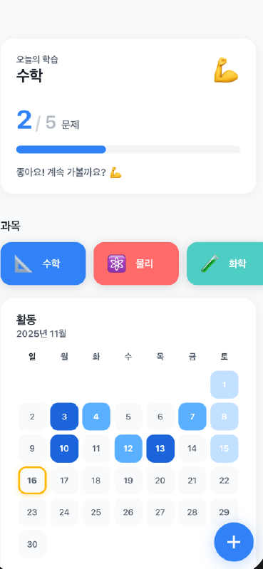
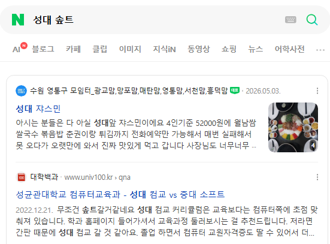
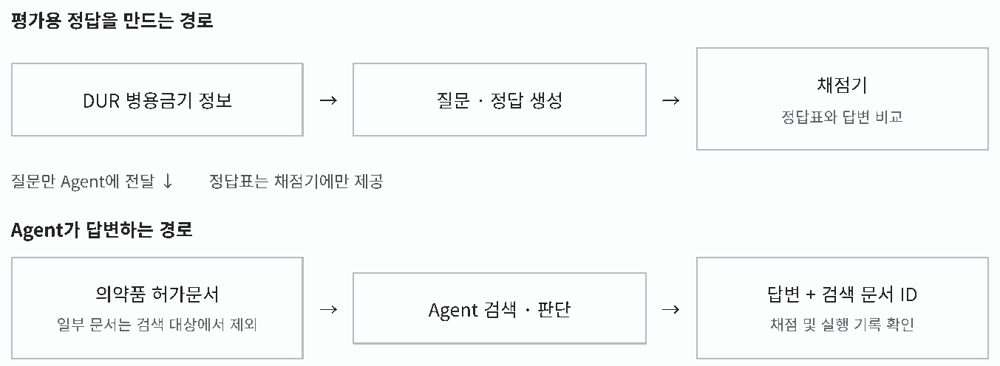
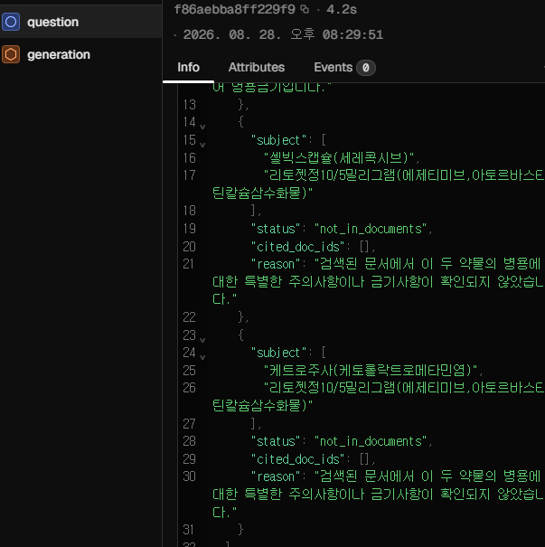

# AI의 실무 도입에 진심인 이준한입니다.

[상세 포트폴리오 PDF](docs/portfolio.pdf) · [GitHub 프로필](https://github.com/vlackvan)

## 목차

1. [제때제때](#1-제때제때)
2. [RAG 알고리즘 튜터](#2-rag-알고리즘-튜터)
3. [네이버 인턴십](#3-네이버-인턴십)
4. [졸업프로젝트 Agent Evaluation](#4-졸업프로젝트-agent-evaluation)

## 개요

해커톤에서 '할루시네이션에 대한 대처가 안되어있다' 라는 지적을 받은 후, AI를 어떻게 하면 실제 업무에서 믿고 사용할 수 있지? 라는 고민을 해왔습니다. 이를 바탕으로 알고리즘 동아리에서 쓸 Chatbot 설계, 인턴십에서 실제 시스템을 연동한 Agent 개발, 그리고 현재 졸업프로젝트로 Agent 평가 체계 설계까지 이 고민을 발전시켜왔습니다.

---

## 1. 제때제때

### 첫 AI 서비스 개발, 그리고 혹평

유니드톤 · 2025년 11월 · 4명 · 1일 개발 · 아이디어와 기획 및 발표 주도

### 매일 쓰는 앱을 기획하다

2025년 11월, 해커톤에서 ‘매일매일 쓸 만한 애플리케이션을 개발하라’는 과제를 받았습니다. 당시 스폰서가 LLM과 OCR 서비스를 제공하고 있었고, 저는 두 기능을 함께 활용해 볼 수 있는 아이디어를 제안했습니다. 듀오링고처럼 매일 학습하되, 학습 재료가 제가 공부한 노트라면 어떨까 하는 생각이었습니다.

그렇게 기획한 서비스가 ‘제때제때’입니다. 문서를 파싱하고, 그 내용을 바탕으로 문제를 자동 생성한 뒤, 일일 맞춤 복습으로 연결하는 앱이었습니다. 네 명이 하루 동안 개발했고, 저는 아이디어와 기획, 발표를 주도했습니다.

*과목별 학습 진도와 일일 활동을 보여 주는 제때제때 화면. 해커톤 발표 자료에서 발췌했습니다.*

### 발표에서 답하지 못한 질문

이 프로젝트는 수상하지 못했습니다. 특히 발표에서 할루시네이션에 어떻게 대처할 것인지 질문을 받았을 때 답하지 못한 일이 기억에 남았습니다. 기능은 완성했지만, AI가 오류를 냈을 때 사용자에게 초래할 결과는 고려하지 않은 것입니다.

학습 서비스의 오류는 잘못된 내용을 배우게 할 수 있습니다. 이 경험을 돌아보며, LLM을 결합한 서비스를 설계할 때는 오류의 비용을 먼저 고려해야겠다고 생각했습니다. 그리고 그 비용이 높다면 어떤 설계로 대비할 수 있을지 고민하게 됐습니다. 해커톤 안에서 해결하지 못한 이 질문은 다음 프로젝트로 이어졌습니다.

---

## 2. RAG 알고리즘 튜터

### LLM을 둘러싼 Context를 설계하다

KAIST 몰입캠프 · 2026년 2월 · 2명 · 1주 개발

**[프로젝트 코드 — boj-ai-tutor](https://github.com/vlackvan/boj-ai-tutor)**

### 정답을 전부 알려주지 않는 학습 도구

2월, 알고리즘 동아리 회장이었던 친구에게서 한 가지 이야기를 들었습니다. 신입 부원이 문제를 풀다가 막혔을 때 구현 코드나 정답 알고리즘을 전부 알려주기보다, 필요한 부분만 조금씩 알려주며 공부를 도울 수 있으면 좋겠다는 것이었습니다. 그 이야기를 계기로 둘이 알고리즘 튜터를 개발했습니다.

이 프로젝트에서 제가 중요하게 생각한 것은 ‘어떤 근거를 바탕으로, 어디까지 알려줄 것인가’였습니다. 학습자가 스스로 풀 기회를 남기면서도, 제공하는 힌트 자체는 믿을 수 있어야 했습니다.

### 모델에 풀이의 근거를 제공하다

개발 과정에서 LLM에 문제를 바로 물어보는 것만으로는 충분하지 않다는 것을 느꼈습니다. 당시 사용하던 고성능 모델도 어려운 문제에서는 올바른 풀이를 제시하지 못했고, 존재하지 않는 풀이를 만들어 내는 경우도 있었습니다. 해커톤에서 남았던 질문이 다시 떠올랐습니다. 학습을 돕는 답변이라면, 그 답변을 뒷받침할 근거가 필요했습니다.

제가 선택한 방향은 문제별 풀이 정보를 DB로 구성하고, 사용자가 풀 문제를 지정하면 해당 문제의 정보를 가져와 답변 맥락으로 제공하는 것이었습니다. 문제의 접근법과 핵심 논리 등을 XML 형태로 구조화해 LLM에 전달했습니다. 사용자가 선택한 문제 번호를 기준으로 자료와 캐시된 풀이 요약을 읽어 생성 단계에 제공하도록 구성했습니다.

XML은 당시 LLM에 구조화된 내용을 전달하기에 적합하다고 생각해 선택한 형식이었습니다. 형식 자체가 정답을 보장하는 것은 아닙니다. 중요한 설계 의도는 문제에 관한 정보를 명시적으로 제공하고, 모델이 이를 참고해 힌트를 만들도록 하는 데 있었습니다.

~~~xml

  <approach>Digit DP / Math</approach>
  <core_logic>
    For each digit position, calculate contribution
    by counting complete cycles (lower/higher)
    and adjusting for current digit.
  </core_logic>
  <complexity>
    <time>O(log N)</time>
    <space>O(1)</space>
  </complexity>
  <edge_cases>N is power of 10, leading zeros</edge_cases>

~~~

*풀이 요약의 XML 형식 예시. 접근법, 핵심 논리, 복잡도, 경계 조건을 구분해 전달합니다.*

### 같은 근거도 한 번에 전부 알려주지는 않도록

풀이 정보를 제공하는 것만으로는 학습 도구의 목적을 충족할 수 없었습니다. 정확한 풀이를 알고 있어도 처음부터 전부 알려주면, 사용자가 스스로 생각할 기회가 줄어들기 때문입니다. 그래서 문제별 힌트 단계를 상태로 관리하고, 다음 힌트를 요청할 때 단계가 올라가도록 설계했습니다.

~~~typescript
async incrementHintLevel(problemId: string): Promise<number> {
    const hintLevels = this.globalState.get<ProblemHintLevels>(
        HINT_LEVELS_KEY, {}
    );
    const currentLevel = hintLevels[problemId] || 0;
    const newLevel = Math.min(currentLevel + 1, 4);
    hintLevels[problemId] = newLevel;
    await this.globalState.update(HINT_LEVELS_KEY, hintLevels);
    return newLevel;
}
~~~

*문제별 힌트 단계를 관리하는 코드. 다음 힌트를 요청하면 한 단계씩 증가시키고, 마지막 단계인 4를 넘지 않도록 제한합니다.*

생성 단계에는 각 수준에서 공개할 수 있는 정보를 지정했습니다. 처음에는 개념적인 방향만, 다음에는 알고리즘이나 자료구조의 이름을, 이후에는 논리적 개요와 부분 코드를 제공하고, 마지막에 전체 풀이를 공개하도록 했습니다. 단계 전환은 코드로 관리하고, 답변의 정보 범위는 프롬프트로 지시하는 구조였습니다. 단계 관리와 별개로, 실제 답변이 그 범위를 지키는지는 생성 결과를 검토해야 하는 부분으로 남았습니다.

### 어떤 맥락을 주느냐가 중요하다는 경험

이 프로젝트를 통해 LLM 기반 설계의 핵심은 모델을 둘러싼 맥락이라는 것을 배웠습니다. 적시에 필요한 만큼만 제공하는 Context와, 이를 기반으로 명확하게 설계된 입출력 구조가 답변의 품질을 결정했습니다.

인턴십 지원서에도 이 경험을 바탕으로 ‘어떤 데이터를 어떻게 주입하느냐’가 응답 신뢰도에 중요하다는 생각을 적었습니다. 검색 시스템의 데이터와 LLM을 연결해 품질 개선에 기여하고 싶다는 관심이었고, 이후 인턴십에서 이를 실제 시스템 안에서 다루게 됐습니다.

---

## 3. 네이버 인턴십

### 실제 시스템과 연계한 Agent를 개발하다

네이버 · 2026년 3월 ~ 2026년 5월(2개월) · 단독 과제 수행

### 찾는 문서가 명확한 질의를 다루다

인턴십에서 맡은 과제는 찾는 문서가 뚜렷한 질의의 검색 결과를 개선하는 일이었습니다. 특정 기업이나 정부 기관의 공식 홈페이지, 또는 채용과 IR처럼 목적이 명확한 하위 페이지를 찾는 경우가 해당했습니다. 정답 문서가 검색 시스템 안에 있어도 결과 상위에 나오지 않는 사례가 있었습니다.

사내에는 이미 검색 결과를 보고 LLM이 적절한 문서를 선택하는 Labeler가 있었습니다. 저는 그중에서도 정답 문서가 명확한 질의에 범위를 좁혔습니다. 목표는 한 번의 검색 결과에서 문서를 고르는 데서 더 나아가, 필요한 단서를 얻고 질의를 바꾸어 다시 검색하면서 목적 문서를 찾아가는 Agent를 설계하는 것이었습니다.

### 실패 사례 700건에서 확인한 두 가지 문제

먼저 기존 LLM 방식으로 해결하지 못한 사례를 분석했습니다. 정답 문서와 LLM이 잘못 선택한 결과를 비교해 실패 유형을 분류하는 AI 도구를 만들었고, 이를 활용해 약 700건을 살펴봤습니다. 이 과정에서 질의의 의도를 이해하지 못하는 문제와, 같은 질의에도 문서 선택이 달라지는 문제를 주요 개선 대상으로 잡았습니다.

### 검색 결과를 질의 해석의 근거로 활용하다

첫 번째 문제는 변경된 명칭이나 낯선 표현이 들어간 질의였습니다. LLM이 그 표현과 찾는 대상의 관계를 알지 못하면, 사용자가 어느 문서를 원하는지 제대로 판단하기 어려웠습니다. 이때 질의를 해석할 단서를 기존 검색 결과에서 얻도록 했습니다.

*질의 해석을 설명하기 위한 검색 화면 예시입니다. ‘성대솦트’라는 입력만으로는 ‘성균관대 소프트웨어’를 뜻한다고 해석하기 어렵지만, 검색 결과의 ‘성균관대학교 컴퓨터교육과’, ‘성대 솦트’ 같은 표현에서 관계를 추론할 단서를 얻을 수 있습니다.*

검색 상위 10개 문서에서 빈도(DF)가 높은 핵심 용어를 추출하고, 그 의미와 원래 검색어 사이의 관계를 추론하는 Loop Agent를 구현했습니다. Agent가 추론한 내용을 질의 해석의 근거로 활용하고, 필요한 용어를 검색어에 추가해 다시 검색하도록 했습니다.

스스로가 원하는 페이지를 검색 시스템에 쳐보는 과정을 생각해보며 이 방법을 고안했습니다. 첫 검색으로 원하는 페이지가 나오지 않으면, 그래도 연관된 검색결과를 살펴보고, 그 안에서 Key Term을 뽑아서 다음 검색어에 활용하는 workflow를 Agent에 맞게 적용한 것입니다.

### 기존 검색 점수로 문서 선택을 제한하다

두 번째 문제는 판단의 비결정성이었습니다. 같은 질의에서도 LLM이 선택하는 문서가 달라졌습니다. 문서 선택을 LLM의 판단에만 맡기기에는 불안정한 부분이 있었고, 기존 검색엔진이 계산하는 GBDT 점수를 가드레일로 활용했습니다.

실험으로 임계값을 정하고, LLM이 선택한 문서의 점수가 그보다 낮으면 해당 선택을 제외하도록 설계했습니다. LLM은 낯선 표현을 해석하고 후보를 판단하는 역할을 맡고, 기존 검색 점수는 그 선택을 받아들일지 제한하는 기준으로 사용했습니다. 두 시스템이 제공하는 정보를 함께 활용해 문서 선택을 관리하려는 접근이었습니다.

### 평가에서 확인한 개선과 역할 분담

당시 평가에서 기존 LLM 방식 대비 F1@1을 79%에서 85%로 6%p 높였습니다. 또한 상위 3위 밖에 있던 정답 문서의 37.5%를 상위 3위 안으로 회복했습니다. 맥락 보강과 가드레일을 함께 적용한 최종 시스템 기준의 결과입니다.

이 경험을 통해 새로운 기술이 한계에 부딪혔을 때 기존 시스템이 잘하는 일에서 해결책을 찾는 법을 배웠습니다. LLM이 이해하지 못한 표현에는 검색 결과에서 찾은 단서를 제공했고, 문서 선택이 흔들릴 때에는 기존 검색 점수로 선택을 제한했습니다. 모델과 검색 시스템의 강점과 한계를 이해하고, 각각의 역할을 정하는 일이 중요했습니다.

### 개선 결과를 넘어 개선 과정에 남은 질문

인턴십에서는 Agent의 구조와 출력을 설계하고, 기존 기능을 연결하며, 평가 결과를 바탕으로 개선하는 과정을 경험했습니다. 그중에서도 Agent의 평가와 개선에는 더 다루고 싶은 문제가 남았습니다. 최종 성능이 좋아졌다는 사실과, 실패가 어느 단계에서 발생했는지를 설명하는 것은 서로 다른 일이었습니다.

실행 결과를 직접 읽으면 개별 실패를 이해하는 데 도움이 됩니다. 하지만 수정 전후의 차이를 같은 기준으로 비교하려면 체계적인 기록과 평가가 필요했습니다. 이전의 실패가 해결됐는지, 다른 사례에 새로운 문제가 생기지는 않았는지도 확인해야 했습니다. 이를 개발자의 기억과 개별 사례 검토에만 맡기지 않고, 반복해서 확인할 수 있는 체계로 만들고 싶었습니다.

---

## 4. 졸업프로젝트 Agent Evaluation

### 실무에서 AI를 활용하기 위한 평가 체계를 고민 중...

성균관대학교 · 2026년 8월 ~ 현재 · 단독 진행

**[프로젝트 코드 — DUR-agent](https://github.com/vlackvan/DUR-agent)**

### 문제제기

인턴십에서 Agent를 개선할 때는 실패한 답변을 직접 읽고, 프롬프트나 처리 방식을 수정한 뒤 다시 실행했습니다. 개별 문제를 이해하는 데는 도움이 됐지만, 무엇이 나아졌고 다른 사례에는 어떤 영향을 줬는지 같은 기준으로 비교하기 어려웠습니다. 정답을 맞혔는지만 봐서는 필요한 자료를 찾지 못한 것인지, 찾고도 잘못 판단한 것인지 구분할 수 없었습니다.

업무용 Agent를 개선하려면 결과가 나온 과정까지 확인할 수 있어야겠다고 생각했습니다. 그래서 졸업프로젝트에서는 질문부터 검색, 답변, 채점까지 연결하고, 평가 결과에서 해당 실행 기록으로 돌아가 실패 원인을 살펴볼 수 있는 파이프라인을 만들기로 했습니다.

### 데이터셋 조건 설정과 데이터 파이프라인 설계

먼저 평가에 사용할 데이터의 조건을 정했습니다. 답이 맞는지 판단할 기준이 있어야 했고, 문서를 찾아 그 내용을 해석해야 풀 수 있는 과제여야 했습니다. 실제 업무에서는 필요한 자료가 빠져 있을 수도 있으므로, 정보를 찾을 수 없는 상황도 재현할 수 있어야 했습니다. 이 조건에 맞춰 식약처 DUR 병용금기 정보와 의약품 허가정보를 선택했습니다.

- **DUR 정보 → 처방·조제 시 안전한 의약품 사용을 돕는 데이터**\
  병용금기, 연령·임부 금기 등 주의가 필요한 조건을 제공합니다. 이 중 병용금기 정보는 함께 사용하면 안 되는 성분 조합과 사유가 구조화되어 있어, 평가용 정답을 만드는 데 사용했습니다.

- **의약품 허가문서 → 개별 의약품의 허가된 사용 정보를 담은 문서**\
  성분, 효능·효과, 용법·용량, 사용상의 주의사항 등을 담고 있습니다. Agent가 문서 속 병용 관련 근거를 찾아 판단하도록 검색 자료로 사용했습니다.

두 데이터의 역할은 분리했습니다. DUR에 등재된 관계로 질문과 정답을 만들고, Agent는 허가문서를 검색해 답하도록 했습니다. 정답표는 채점기에만 제공했습니다. 이렇게 해야 정답과 일치하는 답을 냈는지와, 그 판단에 필요한 문서를 실제로 찾아봤는지를 각각 확인할 수 있다고 생각했습니다.

*보고서의 데이터 흐름을 재구성한 개념도. 정답을 만드는 자료와 Agent가 검색하는 자료를 분리했습니다.*

이렇게 만든 질문을 Agent에 전달하고, 검색한 문서와 최종 답변을 저장한 뒤 정답과 비교하도록 연결했습니다. 검색 기록에는 실제로 반환된 문서 ID를 남겨, 답변에서 근거를 확인했다고 말하는 것과 정말 검색한 것을 구분할 수 있게 했습니다.

### 기본적인 지표 설계

저장된 데이터와 코드로 확인할 수 있는 세 가지 항목부터 평가했습니다.

- **Precision / Recall / F1 → 병용금기를 얼마나 정확히 찾았는가**\
  DUR 정답과 Agent의 판정을 비교했습니다.

- **Context Recall → 판단에 필요한 문서를 찾았는가**\
  근거 문서가 검색 대상에 있는 약품 쌍 중, 지정한 관련 문서를 하나 이상 검색한 비율입니다.

- **Deferral Rate → 근거가 없을 때 판단을 유보했는가**\
  근거 문서를 검색 대상에서 제외한 약품 쌍 중, not_in_documents로 응답한 비율입니다. 답을 맞히는 능력과 정보가 부족할 때 멈추는 행동을 구분해 확인했습니다.

| 같은 병용금기 약품 쌍 | 일반 조건 | 근거 제외 조건 |
| --- | --- | --- |
| DUR 정답 | 병용금기 | 병용금기 |
| 검색 대상의 근거 문서 | 포함 | 제외 |
| 기대하는 답변 | 근거를 찾아 병용금기 판정 | not_in_documents 근거 부족으로 판단 유보 |
| 평가에서 확인할 것 | 정답 일치와 관련 문서 검색 | 판단 유보 여부 |

*평가 조건을 설명하기 위한 비교 예시이며, 실제 실험 결과가 아닙니다. DUR 정답이 같아도 검색 가능한 근거가 없으면 기대하는 행동을 다르게 설정했습니다.*

이 기준으로 베이스라인을 실행하고 Phoenix 기록을 살펴보던 중, 검색 단계가 없는데도 검색된 문서에서 근거를 확인한 것처럼 설명한 사례를 발견했습니다. 최종 답변만 읽어서는 놓칠 수 있는 문제였습니다. 이 사례를 통해 검색 수행 여부와 답변의 설명이 일치하는지도 평가해야 한다는 다음 과제를 찾았습니다.

*실제 Phoenix 캡처. 왼쪽에는 question과 generation만 남아 있지만, 오른쪽 답변은 “검색된 문서”를 근거로 설명합니다. 답변의 설명과 실제 실행 기록이 일치하는지를 확인할 필요가 드러난 사례입니다.*

### 현재 구현한 범위와 앞으로의 개선

현재까지 질문과 정답을 만드는 데이터 파이프라인, Agent의 검색·답변 기록, 자동 채점을 연결한 베이스라인을 구현했습니다. 이를 실행해 검색하지 않고도 문서를 확인한 것처럼 설명하는 실패를 발견했습니다.

앞으로는 답변이 실제 검색 근거에 부합하는지 평가하고, 검색 방식과 출력 지시를 수정한 뒤 같은 문항에서 개선 여부를 비교하겠습니다. 이 과정을 통해 업무용 Agent의 실패 원인을 진단하고, 수정 효과를 검증해 품질을 개선하는 역량을 쌓겠습니다.
